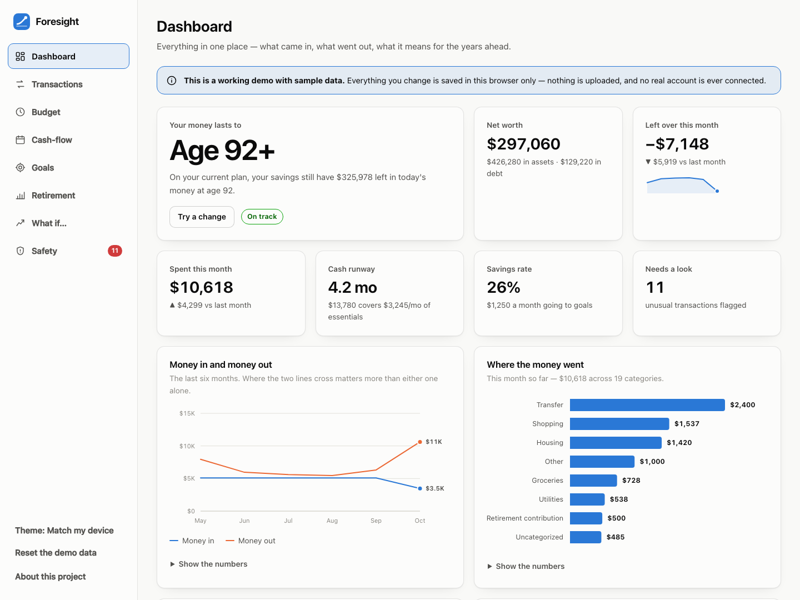

# Foresight — Personal Finance, Retirement Planning & Financial Safety

**Live site: <https://yvonne239.github.io>**

A web platform that connects today's spending decisions, tomorrow's retirement goals,
and protection against financial fraud — in one browser-based tool with no server,
no accounts, and no bank connections.



---

## Why it exists

Most personal-finance tools answer one question at a time. A budgeting app won't tell you
what this month means for age 85. A retirement calculator doesn't know that a $2,400 wire
transfer left your account on Tuesday. And almost nothing in either category takes seriously
that the people with the most savings to protect are the ones most often targeted by fraud.

Foresight puts the three together: **today**, **tomorrow**, and **what could go wrong in between**.
Change a transaction's category and the budget, the cash-flow calendar, and the retirement
projection all move with it.

## What it does

| | |
|---|---|
| **Financial dashboard** | Income, spending, savings, debts and retirement goals in one view, led by the single number that matters most: how long the money lasts. |
| **Import & categorisation** | Upload a bank CSV, paste rows, or add spending by hand. Every guessed category shows the word it matched, so corrections take a second. |
| **Personalised budgeting** | Adjustable budgets for essentials, discretionary spending, debt payments and savings — or set them all at once from your last three months. |
| **Cash-flow calendar** | Income and bills mapped day by day with a running balance, so a shortfall shows up while there is still time to move a payment. |
| **Savings-goal planner** | Emergency, retirement, travel and family-support goals, each with a target, a monthly contribution, and the month it actually finishes. |
| **Retirement income planner** | Expected spending set against pension, Social Security, part-time work and portfolio withdrawals, year by year, with every assumption written out. |
| **Scenario simulator** | Retire later, work part-time, claim Social Security at 70, watch markets disappoint — drag one slider and the whole projection responds. |
| **Alerts & scam checker** | Unusual charges flagged with the reason spelled out, plus a checker for the message or call you aren't sure about. |

## Running it locally

There is no build step and no dependencies. The only requirement is a static file server,
because the app uses ES modules (which browsers refuse to load from `file://`).

```bash
git clone https://github.com/yvonne239/yvonne239.github.io.git
cd yvonne239.github.io
python3 -m http.server 8000
# then open http://localhost:8000
```

## How it is built

Plain ES modules, no framework, no bundler, no third-party scripts, no analytics.

```
index.html              Landing page
app.html                Application shell
favicon.svg
assets/css/app.css      Design tokens, light/dark themes, layout
assets/js/
  app.js                Hash router, sidebar, theme, render loop
  store.js              State + localStorage + the seeded demo data
  format.js             Money, dates, small numeric helpers
  categories.js         Categories, budget groups, keyword rules
  analytics.js          Monthly flows, budget status, cash-flow projection
  projection.js         Year-by-year retirement model
  anomalies.js          Unusual-transaction checks
  scam.js               Scam-pattern library
  charts.js             SVG chart primitives
  ui.js                 Shared presentational pieces
  views/                One module per screen
```

### Design decisions worth knowing about

**Every chart has a table.** Values are never locked inside a hover tooltip. Every chart is
also keyboard-navigable (focus the plot, then use the arrow keys).

**Every projection shows its assumptions.** Return rates, inflation, Social Security claiming
adjustments, and — importantly — what is *not* modelled.

**Every alert explains itself.** A flag you can't interrogate is a flag that teaches people to
ignore flags. Each one names the rule that fired and the number behind it.

**Built for the people most often targeted.** Large type, high contrast, generous hit targets,
plain language, and a light/dark theme that respects the system setting.

### The retirement model

One balance, one return rate, one inflation rate, with income sources netted against an
inflating spending need, computed year by year from your current age to the age you plan
through. Social Security is adjusted for claim age using the real SSA formula (roughly
−6.67%/yr for the first three years early, −5%/yr beyond that, +8%/yr for each year delayed
past full retirement age up to 70). Pensions can be modelled with or without a cost-of-living
adjustment.

It does **not** model tax, sequence-of-returns risk, long-term care, or market variance.
It assumes one steady rate of return every year, which no real market provides.

### The safety checks

Unusual-transaction rules: hard-to-reverse payment types (gift cards, wires, crypto, instant
transfers, remote tech support), charges several times the typical amount for their category,
first-time merchants above a threshold, duplicate charges within three days, out-of-area and
card-not-present charges, and avoidable fees. Methods that are perfectly ordinary in daily
life only raise a flag when the payee is also new or the amount is out of character — a rule
that fires on half of a normal month is a rule people learn to ignore.

The scam-awareness checker recognises fourteen patterns, including the ones fraud teams treat
as near-certain: *"move your money to a safe account"*, *"don't tell anyone"*, and *"read me
the code we just sent."* It never returns a verdict — it names what matched, shows the exact
words, and says what to do next.

## Privacy

Everything runs in the browser. The demo ships with generated sample data; anything you
change is written to that browser's `localStorage` and nowhere else. No network requests are
made to anything other than the static files themselves. Clearing your browser data clears
Foresight with it.

## Disclaimer

Foresight is an **educational demonstration**. It is not financial, tax, investment or legal
advice, and it is not a substitute for a qualified professional who knows your situation.
The projections are deliberately simple; treat the shape of the answer as useful and the
decimal places as fiction. The safety tools find patterns, not truth — a sophisticated scam
may match none of them, and an ordinary message from your bank may match several.

If money is at stake right now, call your bank on the number printed on your card and ask for
the fraud team. In the US you can also report to the FTC at
[reportfraud.ftc.gov](https://reportfraud.ftc.gov), or call the National Elder Fraud Hotline
on 833-372-8311.

## Licence

[MIT](LICENSE).
